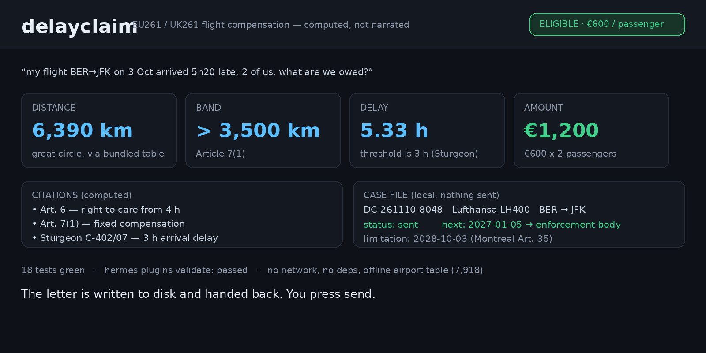

# Delayclaim

**EU261 / UK261 flight compensation, computed and tracked — inside Hermes.**



Airlines are legally required to pay fixed compensation when a passenger reaches
their final destination three hours or more late. Most people never claim,
because working out the figure is fiddly: which regulation applies, how far the
flight was, which distance band that falls in, whether the 14-day cancellation
window was met, and whether the airline's "extraordinary circumstances" line
holds. Delayclaim computes all of that, deterministically, and then keeps the
claim until it is paid.

## What it answers

| | |
|---|---|
| **assess** | `delayclaim_assess` takes the route, the scheduled and actual arrival, and the party size, and returns the amount per passenger and the total, the distance band, the right-to-care threshold and the articles relied on |
| **letter** | `delayclaim_letter` drafts the formal claim: the figures, the Article 7 band, the Sturgeon citation, the 14-day window, and a request for the airline's Article 5(3) basis. Written to the plugin's data directory and returned as Markdown |
| **case file** | `delayclaim_case_open` stores the assessment as a case with the passenger, carrier, flight and letter; `delayclaim_case_update` records "sent", the airline's reply and the outcome; `delayclaim_case_list` shows what is outstanding, what was recovered, and the next date that matters |
| **airports** | `delayclaim_airport` resolves a city or hotel name to an IATA code from the bundled table, so a claim never depends on the model remembering an airport |

## The engine is deterministic

Every headline number is computed, never narrated:

- **distance** — great-circle from a bundled table of 7,918 airports, summed across
  connection segments (Art. 7(1) measures to the final destination)
- **band** — `<= 1,500 km`, `1,500–3,500 km`, `> 3,500 km`
- **amount** — EU: €250 / €400 / €600; UK: £220 / £350 / £520, per passenger
- **threshold** — 3 h arrival delay (Sturgeon, C-402/07 and C-432/07)
- **cancellation** — no compensation at ≥ 14 days notice (Art. 5(1)(c)(i)), none
  when re-routing lands within 2/3/4 h by band
- **defence** — an Art. 5(3) "extraordinary circumstance" blocks payment, and the
  letter demands the specific circumstance and the measures taken
- **care** — the Art. 6 right to meals starts at 2/3/4 h by band, independent of
  compensation

The same flight always produces the same figure. There is no model call anywhere
in the engine, no network call, and the airport and country tables ship in the
repository, so it works offline and inside a sandbox.

## Install

```bash
hermes plugins install DECRUX9812/hermes-plugin-delayclaim --enable
```

No API key, no Python dependency, no account. It also works as a standalone
plugin directory dropped into `~/.hermes/plugins/delayclaim/`.

## Use

```
> my flight BER→JFK on 3 Oct arrived 5h20 late, 2 of us. what are we owed?

✈️ delayclaim_assess
   BER → JFK, 6,390 km (> 3,500 km), arrived 5.33 h late
   Art. 7(1): €600 per passenger — €1,200 for 2
   Art. 6 care from 4 h · citations: Art. 6, Art. 7(1), Sturgeon C-402/07

> draft the claim and keep track of it

✈️ delayclaim_letter   → letter written to plugin-data/delayclaim/letters/…
✈️ delayclaim_case_open → DC-261103-0042, next action 2026-12-29

> I sent it today

✈️ delayclaim_case_update → status: sent, escalate by 2027-01-05 if no reply
```

## What it deliberately does not do

**It never contacts an airline.** No SMTP, no scraping, no auto-send, no browser
automation of a claim form. The letter is written to disk and handed back; you
send it. That is a design decision, not a limitation: a claim sent on your behalf
without you reading it is a liability, and Hermes' approval gate would have to
stand in front of every send anyway. Delayclaim puts the work where it is
reliable — the arithmetic and the paper trail — and leaves the one irreversible
step to you.

Under cron and unattended runs this means nothing can be sent by accident: the
tools only read and write local files, so there is nothing to hang on a prompt.

## Disclosure

- **Network calls:** none. The airport and country tables are bundled.
- **Reads outside its own data:** nothing. It reads only its own bundled tables.
- **Writes:** `plugin-data/delayclaim/letters/*.md` (draft letters) and
  `plugin-data/delayclaim/cases.db` (the case file). Both follow the active
  profile and survive `hermes plugins update`.
- **Credentials:** none requested, none stored.
- **Shell commands:** none. No subprocess is spawned.
- **Python dependencies:** none.
- **Not legal advice:** the assessment is a computed reading of Regulation (EC)
  No 261/2004 and its UK retained version. The airline decides; a national
  enforcement body or a court decides disputes.

## Scope and limits

- Covers **EU261** (EU/EEA/Switzerland departures; arrivals on a Union carrier)
  and **UK261** (UK departures; arrivals on a UK carrier). It reports when a
  route falls outside both rather than guessing.
- The US has no equivalent fixed-compensation regime (DOT rules give refunds, not
  payouts), so a US domestic claim is flagged as out of scope instead of being
  mispriced.
- The letter is a starting point in English. It cites the regulation and the
  case law, and states the figures the engine computed.

## Tests

```bash
python3 -m pytest tests/ -q          # engine: bands, regimes, thresholds, defences
hermes plugins validate .            # the same gate catalog CI runs
```

The engine tests are pure functions over the bundled tables — no mocks, no
network, and a failing band or notice-window assertion fails the build.

## Licence

MIT. Airport coordinates from the open `mwgg/Airports` dataset (public domain);
country names from ISO 3166-1.
